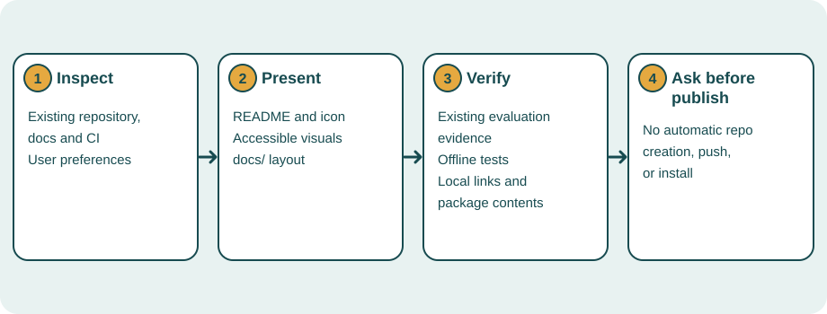
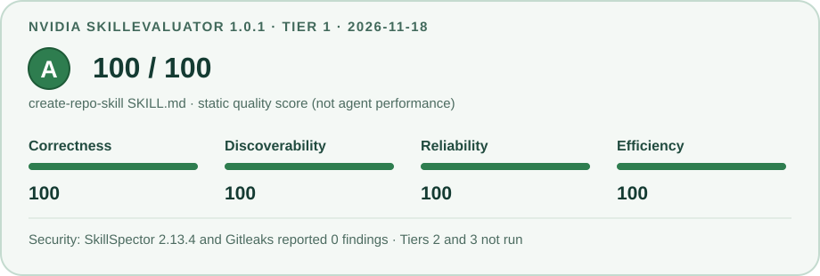

<p align="center"></p>

# create-repo-skill

  

An Agent Skill that helps an AI agent create or refresh a repository's public face: README, icon, accessible diagrams, docs layout, honest evaluation reporting and test presentation. It keeps the project's code and layout intact and asks before publishing anything.

## How it works

<p align="center"></p>

| Area | Guidance |
| --- | --- |
| Presentation | Icon, truthful badges, quick start, accessible visuals, concise docs |
| Structure | `assets/`, `docs/`, `tests/` where they fit; never break existing links or packaging |
| Evidence | Only verified scores, with artifact, revision, tool version, date and limits |
| Verification | Offline tests, local links, package contents |

## Quick start

```bash
npx skills add illescasDaniel/create-repo-skill -a claude-code -a codex -g -y
```

Then ask your agent, for example: *"Give this repo a proper README with an icon and a workflow diagram."* Restart the agent session so it loads the skill.

<details>
<summary>Manual installation</summary>

Copy `skills/create-repo-skill/` to `~/.claude/skills/create-repo-skill/` (Claude Code) or `~/.agents/skills/create-repo-skill/` (Codex). Project-level installs use `.claude/skills/` and `.agents/skills/`.

</details>

## Requirements and limits

- Needs read/write access to the target repository. An image tool or model is optional (the skill falls back to hand-written SVG); `gh` is only needed if you approve publishing.
- It does not write application code or choose a license for you.

## Evaluation

<p align="center"></p>

NVIDIA SkillEvaluator 1.0.1 (Tier 1, static checks, 2026-11-18) on the `skills/create-repo-skill/` working tree before the first commit: 9 of 9 checks passed, quality A (100/100), no security findings from SkillSpector 2.13.4 or Gitleaks. Tiers 2 and 3 (deduplication and live agent runs) were **not run**, and the score does not prove the skill improves agent results. An earlier, shorter revision scored C (79.5) with the security scan not run. Details and limits: [docs/evaluation.md](docs/evaluation.md).

## Tests

The skill is instructions only (no scripts), so there are no script tests; its behavior with a live agent is untested.

## License

MIT, see [LICENSE](LICENSE).
